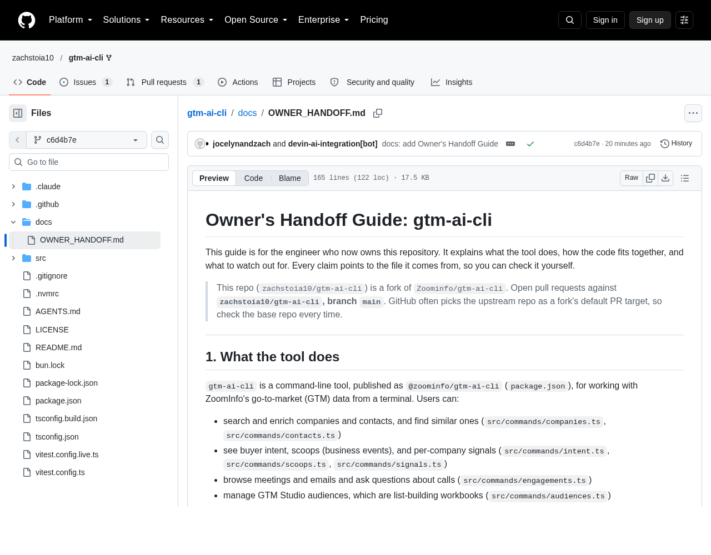
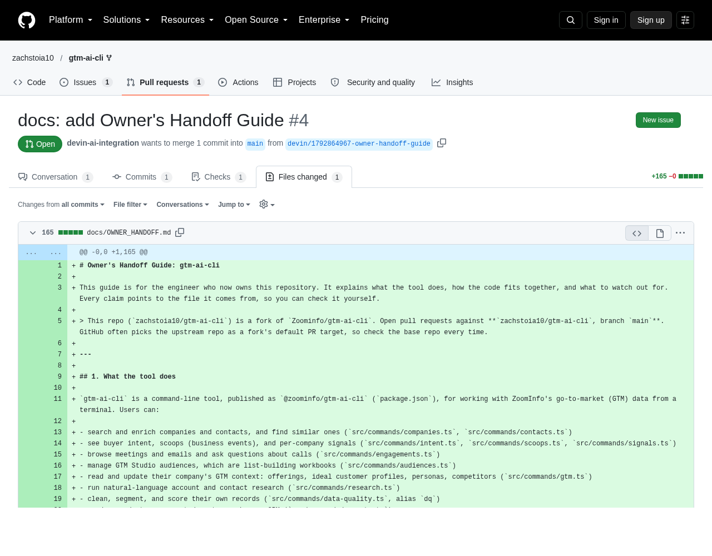

# Inheriting a Codebase with Devin: Walkthrough

**No handoff and no one to ask: how Devin turned an unfamiliar repo into a knowledge transfer before day one.**

> **Please note:** This is a simulated ownership change. The code is a public fork of ZoomInfo's open-source, MIT-licensed *gtm-ai-cli*. No application code was changed. Nothing logged in to ZoomInfo, ran live tests, or contacted any ZoomInfo system or account.

## What you're looking at

**The situation:** A new engineer takes over this tool on Monday. The previous owner has moved on and left no handoff notes and nobody to ask. That's very common at big companies.

**What Devin did:**
- **DeepWiki:** Devin read the whole codebase and wrote a wiki-style guide to it, with diagrams and a page for each part. Every section links to the exact file it describes.
- **Ask Devin:** We asked the questions a new owner would ask the previous engineer, like "What happens when someone searches for a company?" and "Where's the code that handles expired logins?" Devin pointed to the exact files in each answer.
- **Handoff guide:** In about 5 minutes Devin wrote the missing "owner's manual" and flagged risks it found, such as outdated files, wrong instructions in the README and mismatched settings. It ran all 151 tests first to confirm the tool works.

## Results

| ~5 min | 151 / 151 | 1 file | 0 |
|:-:|:-:|:-:|:-:|
| To write the handoff guide | Tests run and passing | Added, with no app code changed | ZoomInfo systems contacted |

## Follow along: 5 steps

### 1. The repo you inherit
**[gtm-ai-cli on GitHub ↗](https://github.com/zachstoia10/gtm-ai-cli)**

A TypeScript command-line tool for ZoomInfo's go-to-market data. It has 15 command groups, two ways of reaching ZoomInfo's servers (MCP and REST), OAuth login with automatic token refresh, and a release pipeline. There's no handoff document and nobody to ask.

### 2. DeepWiki: the codebase explained
**[Open the wiki ↗](https://app.devin.ai/wiki/zachstoia10/gtm-ai-cli)** (requires Devin sign-in)

Devin indexed the repo and generated a wiki. It has an architecture overview, diagrams of how a command flows through the code, and a page per subsystem. Every section links back to the source file it describes.

### 3. Ask Devin: questions answered from the code
Shown live in Devin (requires sign-in).

A new owner asks the questions they would normally ask the previous engineer. Each answer names the exact files and functions, and every one was checked against the code.

- **"Walk me through what happens when someone runs `gtm companies search --name "Stripe"`."**
  The command is parsed in `src/index.ts` and its flags are turned into a request in `src/commands/companies.ts`. `mcpCall` in `src/mcp.ts` sends it to ZoomInfo, and `src/output.ts` prints the results.
- **"Which commands use the REST API instead of MCP, and what would change if the login provider changed?"**
  Only `data-quality` and `exports` use REST (`apiCall` in `src/api.ts`). Both connections share one login session, and the login details live in `src/oauth.ts`.
- **"Where is the code that handles an expired or rejected login token?"**
  `src/credentials.ts`. Tokens are refreshed a minute before they expire. If ZoomInfo rejects a token anyway, `withSession` refreshes it and retries once, then asks the user to log in again.

### 4. The knowledge transfer document
**[Read the Owner's Handoff Guide ↗](https://github.com/zachstoia10/gtm-ai-cli/blob/c6d4b7e17025aae61ee2c18f665f3314479090ed/docs/OWNER_HANDOFF.md)**

A separate Devin session was given one instruction: write the handoff guide the previous owner never left. It ran the full test suite (151 of 151 passed), read the code, and wrote the guide. The guide covers what the tool does, how a request flows, login and token refresh, tests, releases, a first-week checklist, and the risks it found, such as an out-of-date lock file, wrong build paths in the README, Node version mismatches and an unfinished CODEOWNERS file. Every claim cites the file it comes from.

View the guide

### 5. Reviewed by a human before it lands
**[Pull request #4 ↗](https://github.com/zachstoia10/gtm-ai-cli/pull/4)**

Devin doesn't merge its own work. The guide arrives as a pull request that adds one file and changes no application code. Automated checks pass, and it's ready for the team to review and merge.

View the pull request

---
Built with Devin by Cognition.
